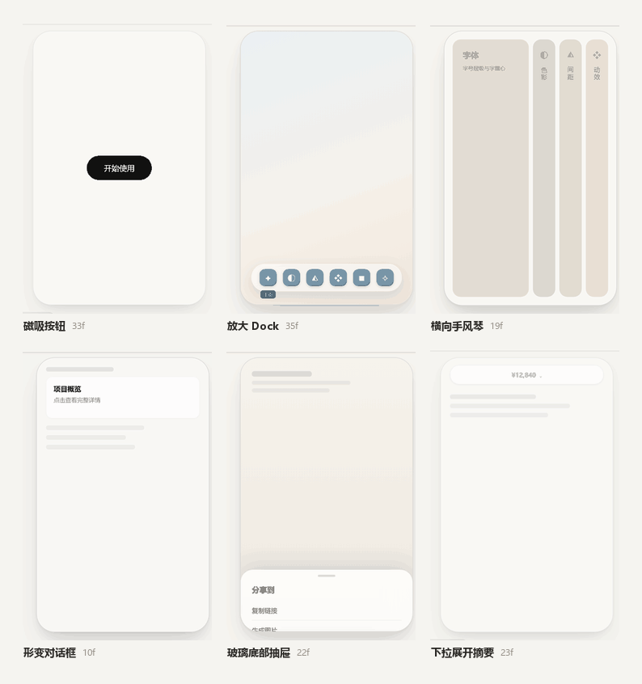
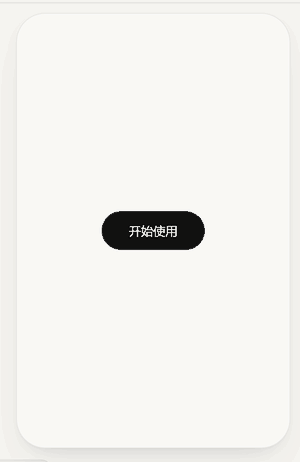
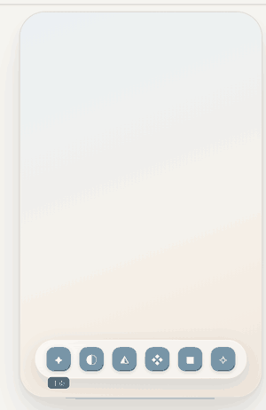
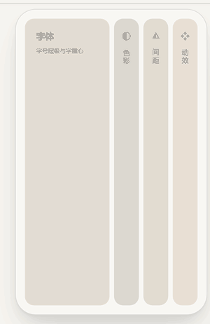
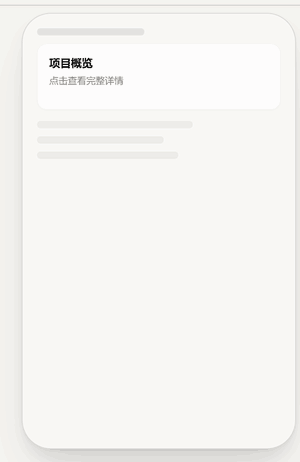
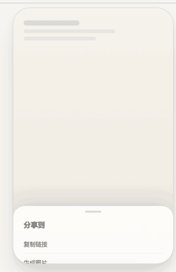
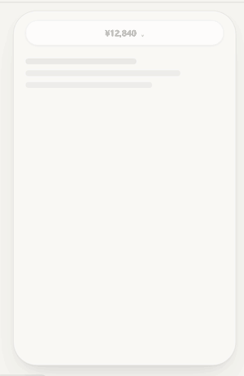

# 设计收藏库 · Design Collection

**把好看的设计，翻译成能直接抄的数值。**

---

## 这个库是怎么来的

作者没事就刷设计。

贴吧、小红书、推特、Dribbble、Mobbin、各路大佬的个人站——看到那种"卧槽这个动效好爽"的瞬间，
就截图存下来。

存多了发现一个问题：**截图没用**。

三个月后翻回去，只记得"这个按钮手感很棒"，但说不出来它到底怎么动的。缩放了多少？弹了几次？
缓动是快出慢入还是慢出快入？全靠猜，等于白存。

所以就有了这个库：**每看到一个好设计，就当场把它拆成参数**。

不是"这个很高级"，而是：

```
位移 A × (1 − d/R)，R = 120px，A = 12px
spring: stiffness 260 / damping 20 / mass 1
```

这样过半年再看，照样能一秒复刻出来。

> 说明：灵感大量来自社区（贴吧、小红书、推特上那些让人眼前一亮的东西），
> 部分条目也参考了开源库的做法（ReactBits、transitions.dev、Magic UI 等，各自的许可见条目内标注）。
> **但条目里的参数都是自己拆解、重写、验证过的技术描述，不是搬运原图或原代码。**
> 每个条目的「来源」一行会标清楚是来自哪。

---

## 现在有什么

**47 个条目**，每个都拆成了可以直接用的规格。其中 **45 个有可跑的交互演示**。

> 🔗 **[在线体验全部 45 个组件 →](https://ethancai330.github.io/social-design-shelf/)**



### 动起来是这样

| 磁吸按钮 | 放大 Dock | 横向手风琴 |
|:---:|:---:|:---:|
|  |  |  |
| **形变对话框** | **玻璃底部抽屉** | **下拉展开摘要** |
|  |  |  |

> 真实交互录屏，参数就是条目里的参数。没加速，没补间。

---

## 分类

按**这个东西作用在哪儿**来分，不是按技术实现分。

| 分类 | 是什么 | 数量 |
|---|---|---|
| **文字动效** Text Animations | 作用在字上的：逐字入场、流光扫过、乱码解码 | 3 |
| **动效效果** Animations | 效果本身：光标拖尾、悬停倾斜、入场 | 8 |
| **微小交互** Micro | 小而精的交互件：磁吸按钮、弹力开关、点击火花 | 8 |
| **结构组件** Components | 有布局的：导航、抽屉、浮层、手风琴 | 14 |
| **背景与材质** Backgrounds | 铺满整块的：边框、毛玻璃、极光、星云 | 9 |
| **数据呈现** Data Display | 数字、进度、加载骨架 | 4 |
| **整页与氛围** Screens | 整页视觉语言 | 1 |

为什么这么分：**「文字流光」和「磁吸按钮」技术上都算动效，但前者只影响字形，后者是个能点的按钮**，放在一起就是乱。按作用对象分，找东西才快。

完整清单见 [INDEX.md](INDEX.md)。

---

## 它跟"设计灵感收藏夹"有啥区别

大多数灵感收藏最后都烂在文件夹里，因为**截图变不成代码**。

| 存截图得到 | 这个库得到 |
|---|---|
| "这个按钮很高级" | 位移 `A × (1−d/R)`，`R=120px`，`A=12px`，spring `260/20/1` |
| "切换很丝滑" | 指示器 spring `320/26/1`，中途宽度拉伸 8%，`200ms` 文字渐变 |
| "有点像玻璃" | `blur(24px)` + 白 72% + `inset 0 0 0 1px rgba(0,0,0,.06)` + 双层阴影 |

---

## 每条长什么样

```yaml
---
id: magnetic-button
title: "磁吸按钮 Magnetic Button"
category: micro
styles: [noir, quiet]
input: pointer
viewport: both
status: verified
---
```

正文六段：**行为 / 时长与曲线 / 视觉 / 细节与反例 / 降级 / 复刻提示词**。

每条还要标：

- **`styles`** — 视觉调性（静谧极简 / 暗黑奢华 / 玻璃拟态 / 瑞士排版 / 东方留白 / 流体渐变）
- **`input`** — 鼠标 `pointer` / 触摸 `touch` / 都要 `both` / 不用输入 `none`
- **`viewport`** — 移动 `mobile` / 桌面 `desktop` / 通用 `both`

---

## 关键：这些参数是查过产出的

这里最容易翻车。很多"AI 写的前端规格"看着专业，其实一写就错。

库里的 `validate.py` 会抓这些：

- **衰减方向写反** —— 写成 `d/R` 就成了"越远位移越大，到边界突然弹回"，正确的是 `1 − d/R`
- **把 `999px` 圆角当数值插值** —— 实际渲染会被 clamp 到半高，动画前 97% 的行程视觉上卡死不动
- **声明"过冲"却给了单调曲线** —— `cubic-bezier(0.32,0.72,0,1)` 的 y 控制点全在 `[0,1]` 里，物理上不可能过冲
- **给了 `stiffness` 却不给 `damping` / `mass`** —— 别人没法复现
- **同时说"1:1 跟手"和"带 0.85 阻尼"** —— 自相矛盾

这些在纸面上完全看不出来，写进代码就是 bug。

---

## 怎么用

### 当 Agent Skill 用

这个目录本身就是一份 skill。扔到你的客户端约定位置：

```bash
# 克隆成一个 skill 目录
git clone <repo-url> ~/.dsh/skills/design-collection

# 或者做符号链接
ln -s /path/to/repo ~/.dsh/skills/design-collection
```

`SKILL.md` 里全是相对路径，不依赖任何绝对路径或用户名。
Claude Code、Cursor、Codex 这些支持 skill / rules 的客户端也能直接用 `SKILL.md` 的正文。

### 只想看看

浏览器打开 `showcase/index.html`。单文件，零依赖，不用联网。

### 校验和重建

```bash
python validate.py               # 校验全部条目，0 错误才算过
python build-index.py            # 从 frontmatter 重建 INDEX.md
python build-index.py --check    # CI 用：只检查一致性
```

---

## 个人审美画像

`taste-profile.md` 是**私人文件**，`.gitignore` 里排除了。

它记的是你个人的偏好——喜欢什么手感、讨厌什么、看到什么会喊卧槽。
AI 收录新条目时会参考它。

从模板开始：

```bash
cp taste-profile.example.md taste-profile.md
```

不存在也没事，AI 会走通用规则。

---

## 贡献

见 [CONTRIBUTING.md](CONTRIBUTING.md)。

门槛就四条：**能参数化、机制认得出来、不是重复条目、说得出反例**。

## 许可

代码 MIT，文档 CC BY 4.0。详见 [LICENSE.md](LICENSE.md)。

**本仓库不含任何人的截图素材**——`references/` 被排除了。
条目里的参数是对交互行为的原创技术描述，不是搬运原图。

## 免责

参数在 Chrome / Safari 上验证过，不保证在所有设备和浏览器上精确复现。
上生产前请真机验证。
